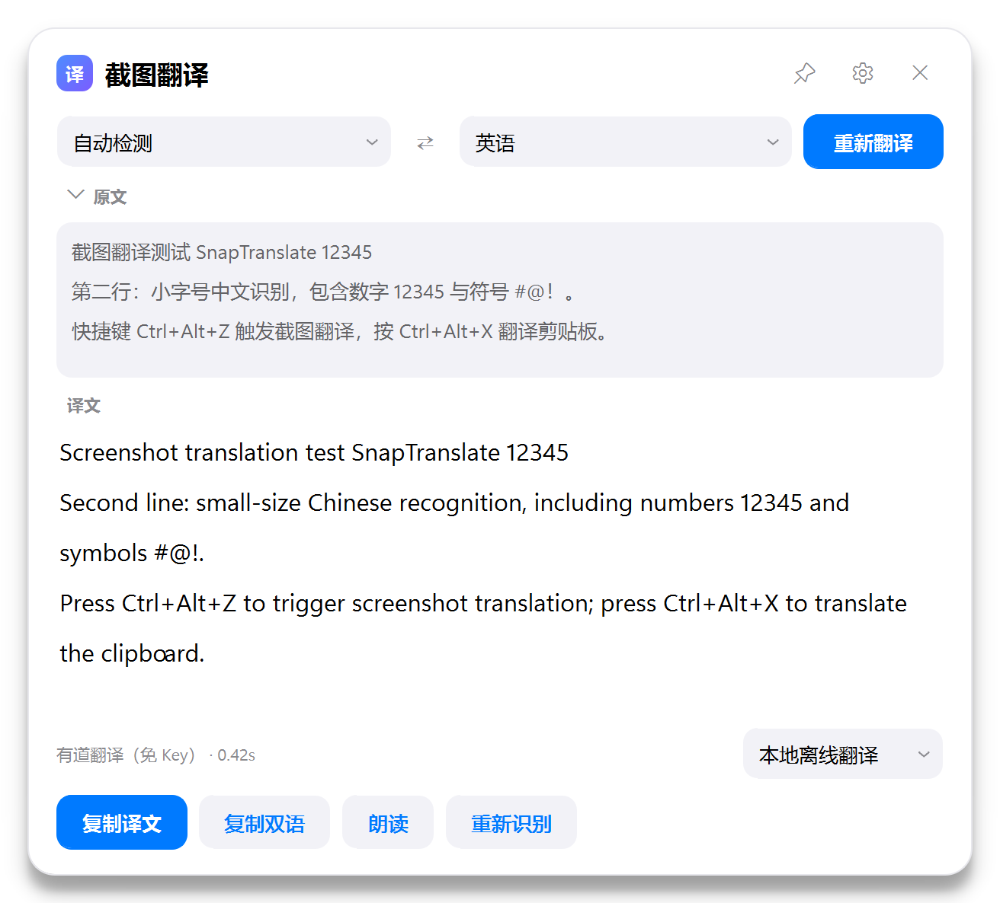
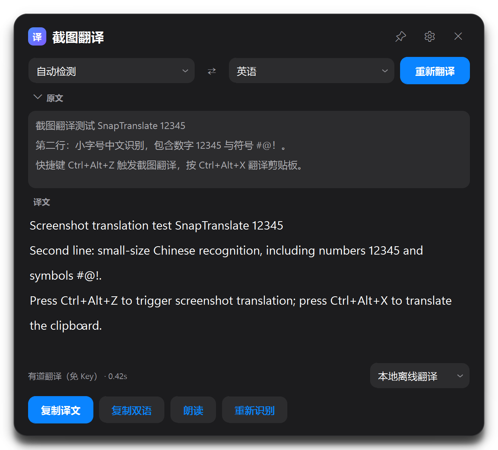
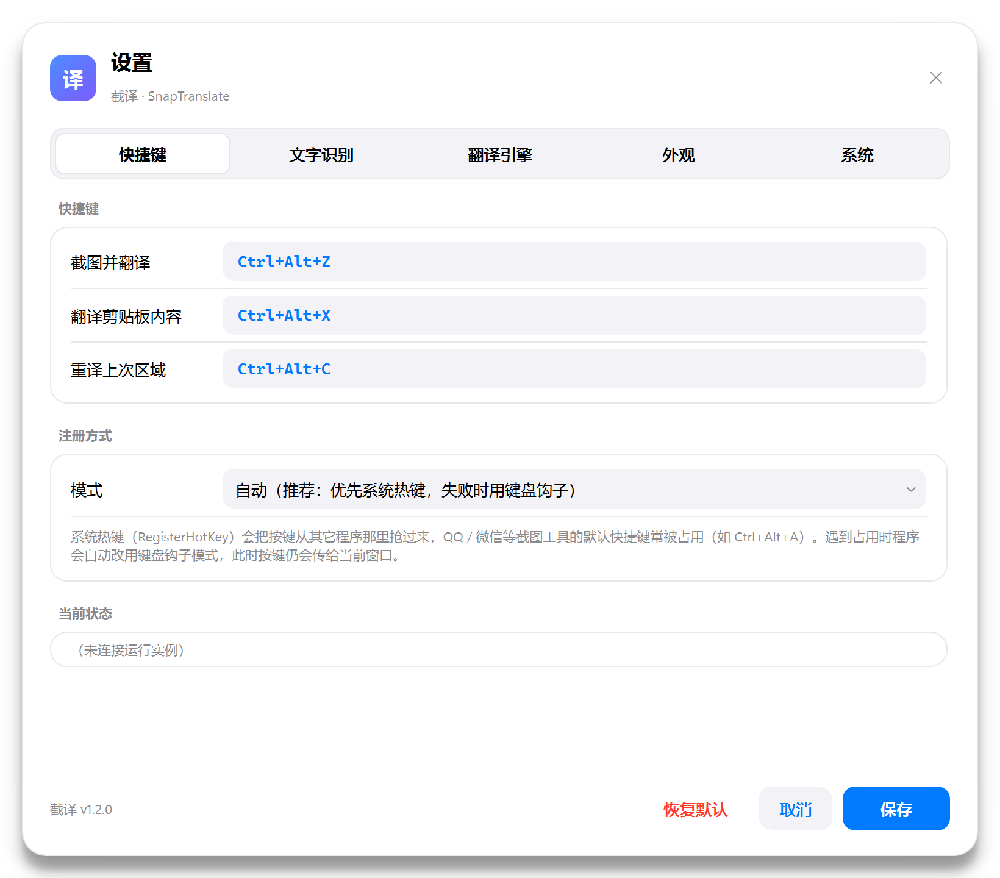
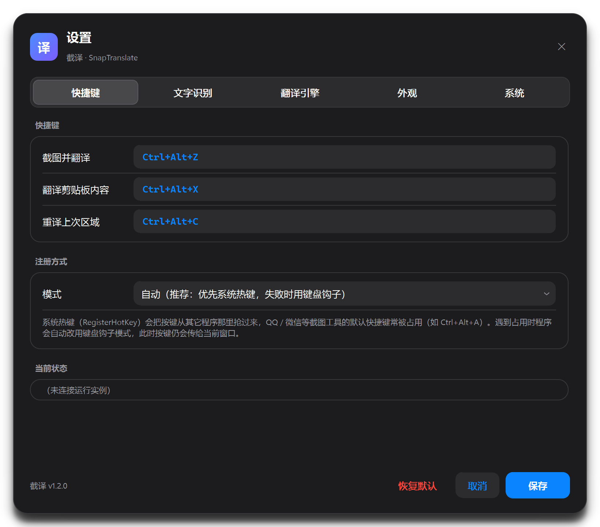

<!-- ═══════════════════════════════════════════════════════════════════════
     SnapTranslate v1.2.0 — bilingual release notes
     语言切换 / Language:  English  ·  简体中文
     ═══════════════════════════════════════════════════════════════════════ -->

# SnapTranslate v1.2.0 · 截译

**English** &nbsp;·&nbsp; [简体中文](#简体中文)

---

## English

> Press a hotkey → drag over any text on screen → offline OCR → floating translation window.

### 🆕 What's new in v1.2.0

**A new iOS-inspired interface — the same translation engine underneath.**

The whole surface was rebuilt around grouped cards, hairline separators and a calmer
light/dark palette. It is still one small tray app: press the hotkey, drag, read.

| Result window — light | Result window — dark |
| --- | --- |
|  |  |

- **iOS system colours** — `#F2F2F7` grouped canvas, white cards and `#007AFF` accent in
  light mode; `#000000` / `#1C1C1E` cards and `#0A84FF` accent in dark mode
- **Custom-painted controls** — animated green switches, a segmented tab bar and a 12-spoke
  activity indicator. Qt stylesheets cannot animate a switch, so `app/widgets.py` draws it
- **Rounded frameless dialogs** — settings and the language-pack manager are cards with a
  custom title bar you can drag; no more square Windows title bar inside the design
- **A more legible result card** — line spacing is set with `QTextBlockFormat`, the engine
  picker moved into the status row, and buttons are grouped iOS-style
- **Restrained selection overlay** — iOS-blue selection border, white circular handles,
  glass-style hint/size pills, and a magnifier with a high-contrast crosshair

| Settings — light | Settings — dark |
| --- | --- |
|  |  |

**Layout and behaviour fixes**

- **No more clipped windows.** The result window now fits long text by growing up to 86% of
  the screen, then giving the text panes their own scrollbars. Action buttons stay visible
- **The source can always be expanded.** The 原文 row is clickable even when the window
  starts collapsed; previously you had to change a setting and capture again
- **Small screens are handled.** Card dialogs clamp themselves to the available screen and
  all settings pages scroll, so the save/reset buttons remain reachable at 125% scaling
- **Disabled buttons look disabled** (the accent/destructive variants used to stay coloured)
- **The version label is correct** — it showed `1.0.0` while the release was `1.1.0`; the
  About card, settings footer and `app.__version__` now all report `1.2.0`
- **The language-pack manager updates from the GUI thread only.** Worker threads emit Qt
  signals instead of touching widgets directly, and they stop on close

**Unchanged**

- OCR (RapidOCR / Windows OCR / Tesseract), translation providers, the offline
  language-pack format, privacy behaviour and hotkey handling are untouched
- The default theme for a fresh install is now **light**; existing configs keep their
  current theme. Switch at any time under **Settings → Appearance**

### 📦 Download

| File | Description |
| --- | --- |
| **`SnapTranslate-win64.zip`** | Portable build. Extract and run `SnapTranslate.exe`. **No Python required.** |
| `Source code (zip)` | Source. Run `python tools\install_deps.py` first. |

> If SmartScreen blocks the first launch, choose **More info → Run anyway** (the binary is not
> code-signed).

### 🚀 Quick start

1. Extract `SnapTranslate-win64.zip`
2. Run `SnapTranslate.exe` (the settings window opens on first start)
3. Press **`Ctrl + Alt + Z`** and drag over any text

| Default hotkey | Action |
| --- | --- |
| `Ctrl + Alt + Z` | Screenshot & translate |
| `Ctrl + Alt + X` | Translate the clipboard |
| `Ctrl + Alt + C` | Re-translate the last region |

**For offline translation:** *Settings → Translation engines → Manage offline packs* →
download Chinese ⇄ English → set the engine to **Local offline translation**.

### ✅ Verified before release

| Item | Result |
| --- | --- |
| UI geometry (`tools/ui_check.py`) | Result window, all 5 settings tabs and the language-pack manager pass; no widget is 0×0 or clipped |
| 200% DPI rendering | 1280×800 logical screen: result 656×593, settings 820×720, no clipped content |
| Long-text clamping | 20-line translation on a 600 px-tall screen → 516 px card; both text panes scroll, action bar visible |
| UI smoke tests | Animated switch, segmented tabs, save → reload, source collapse/expand, clipboard copy, error state |
| Selection overlay | 520×250 selection, circular handles, size badge, magnifier and coordinate pill drawn correctly |
| Version string | `1.2.0` in About, settings footer and `app.__version__` |
| Frozen build | OCR → local translation → display passes (see the build verification log) |

### ⚠️ Known limitations

- **Windows only** (Win32 hotkeys, GDI capture, SAPI speech, WinRT OCR)
- The interface is **iOS-inspired**, not a native macOS port; fonts fall back to
  Segoe UI Variable / Microsoft YaHei UI when SF Pro is not installed
- Offline translation quality is below the online engines — it uses compact OPUS-MT models
  that run on CPU. Use it for privacy; use the online engines (or an LLM key) for polish
- Offline language packs are English-centric: other pairs pivot through English
- Free translation endpoints are rate-limited
- The RapidOCR Chinese model drops spaces between English words (boundary spaces are restored automatically)
- With monitors at **different** scaling factors the overlay may be slightly offset
- The binary is not code-signed

### 🔧 Run from source

```bat
python tools\install_deps.py     :: installs into the local vendor\ directory
python main.py                   :: start
python tools\offline_pack.py --download zh-en en-zh   :: offline language packs
```

See **README.md** for the full guide, FAQ and implementation notes.

### 🙏 Credits

- [RapidOCR](https://github.com/RapidAI/RapidOCR) / [PaddleOCR](https://github.com/PaddlePaddle/PaddleOCR) — offline text recognition
- [CTranslate2](https://github.com/OpenNMT/CTranslate2) / [OPUS-MT](https://github.com/Helsinki-NLP/Opus-MT) — offline translation models
- [Argos Translate](https://github.com/argosopentech/argos-translate) — language-pack format and index
- [PyQt5](https://www.riverbankcomputing.com/software/pyqt/) — GUI
- [mss](https://github.com/BoboTiG/python-mss) — screen capture
- [pynput](https://github.com/moses-palmer/pynput) — keyboard hook fallback

### 📄 License

[MIT](LICENSE)

---

<a id="简体中文"></a>

## 简体中文

> 按下快捷键 → 框选屏幕上任意文字 → 自动识别 → 翻译结果悬浮窗。

### 🆕 v1.2.0 新增

**全新 iOS 风格界面，底层的翻译链路没有变。**

整个界面围绕分组卡片、发丝分隔线和更克制的浅色 / 深色配色重做了一遍。
它仍然是那个托盘小工具：按快捷键、框选、看结果。

| 结果窗口 · 浅色 | 结果窗口 · 深色 |
| --- | --- |
|  |  |

- **iOS 系统色** —— 浅色用 `#F2F2F7` 分组背景、白色卡片、`#007AFF` 强调色；
  深色用 `#000000` / `#1C1C1E` 卡片层级和 `#0A84FF` 强调色
- **自绘控件** —— 带滑动的绿色开关、胶囊分段标签、12 辐条加载指示器。
  Qt 样式表做不出开关动画，所以 `app/widgets.py` 直接绘制
- **圆角无边框对话框** —— 设置窗和语言包管理窗都是可拖动的卡片，
  不再在 iOS 风格界面里露出方正的 Windows 标题栏
- **更好读的结果卡片** —— 行距用 `QTextBlockFormat` 真正拉开，
  引擎选择移进状态行，按钮按 iOS 习惯分组
- **克制的框选遮罩** —— iOS 蓝选框、白色圆形把手、玻璃质感提示 / 尺寸胶囊，
  放大镜换成高对比度十字线

| 设置 · 浅色 | 设置 · 深色 |
| --- | --- |
|  |  |

**布局与行为修复**

- **窗口不再被裁切。** 结果窗现在最多长到屏幕的 86%，再长就给译文/原文区各自加滚动条，
  底部操作按钮始终可见
- **原文随时能展开。** 即使窗口初始是折叠状态，「原文」这一行也可以点开；
  以前只能去设置里改完再截一次
- **小屏幕可用。** 卡片对话框会按屏幕可用区域收尺寸，所有设置页都能滚动，
  125% 缩放下保存 / 恢复默认按钮仍然点得到
- **禁用按钮真的看起来禁用了**（强调色和危险色按钮以前禁用了仍然有颜色）
- **版本号修正** —— 之前界面显示 `1.0.0`、实际发布却是 `1.1.0`；
  现在关于页、设置底栏和 `app.__version__` 统一为 `1.2.0`
- **语言包管理器的线程更安全。** 后台线程只发 Qt 信号，不再直接改控件；关闭时主动停止

**没有改动的部分**

- 识别（RapidOCR / Windows OCR / Tesseract）、翻译引擎、离线语言包格式、
  隐私行为和快捷键逻辑全部保持不变
- 全新安装的默认主题改为**浅色**；已有配置会保留自己当前的主题，
  随时可在「设置 → 外观」切换

### 📦 下载

| 文件 | 说明 |
| --- | --- |
| **`SnapTranslate-win64.zip`** | 免安装版，解压后双击 `SnapTranslate.exe`，**不需要装 Python** |
| `Source code (zip)` | 源码，需要先执行 `python tools\install_deps.py` 装依赖 |

> 首次运行如果被 SmartScreen 拦下，选「更多信息 → 仍要运行」即可（程序没有代码签名）。

### 🚀 快速上手

1. 解压 `SnapTranslate-win64.zip`
2. 双击 `SnapTranslate.exe`（首次会打开设置窗口）
3. 按 **`Ctrl + Alt + Z`** 框选屏幕上要翻译的文字

| 默认快捷键 | 作用 |
| --- | --- |
| `Ctrl + Alt + Z` | 截图翻译 |
| `Ctrl + Alt + X` | 翻译剪贴板 |
| `Ctrl + Alt + C` | 重译上次区域 |

**要用离线翻译**：设置 → 翻译引擎 → 管理离线语言包 → 下载「中文 ⇄ 英语」，
再把「翻译引擎」选为 **本地离线翻译**。

### ✅ 发布前的实测结果

| 项目 | 结果 |
| --- | --- |
| 界面几何（`tools/ui_check.py`） | 结果窗、5 个设置页、语言包管理窗全部通过；没有 0×0 或被裁切的控件 |
| 200% DPI 渲染 | 1280×800 逻辑分辨率下：结果窗 656×593、设置窗 820×720，内容无裁切 |
| 长文限高 | 600px 高屏幕上 20 行译文 → 516px 卡片；两个文本区可滚动，操作栏可见 |
| UI 冒烟测试 | 开关动画、分段标签、保存→重载、原文折叠/展开、复制、错误态全部通过 |
| 框选遮罩 | 520×250 选区、圆形把手、尺寸角标、放大镜和坐标胶囊绘制正常 |
| 版本号 | 关于页、设置底栏、`app.__version__` 均为 `1.2.0` |
| 打包版 | 识别 → 本地翻译 → 显示 全链路通过（见构建验证日志） |

### ⚠️ 已知限制

- **仅支持 Windows**（依赖 Win32 热键、GDI 抓屏、SAPI 朗读、WinRT OCR）
- 界面是 **iOS 风格**，不是 macOS 原生移植；没有 SF Pro 时字体会回落到
  Segoe UI Variable / Microsoft YaHei UI
- 离线翻译质量低于在线引擎——它用的是能在 CPU 上跑的紧凑型 OPUS-MT 模型。
  在意隐私就选它，在意质量就选在线引擎或配置大模型 Key
- 离线语言包以英语为中心：其它语种之间需要经英语中转，会损失一点质量
- 免费在线翻译接口有频率限制
- RapidOCR 中文模型会吞掉英文词间空格（汉字与西文交界处已自动补齐）
- 多显示器**且各屏缩放比例不同**时，框选遮罩按主屏比例渲染，可能有轻微偏移
- 程序无代码签名

### 🔧 从源码运行

```bat
python tools\install_deps.py     :: 依赖装进项目内的 vendor\ 目录
python main.py                   :: 启动
python tools\offline_pack.py --download zh-en en-zh   :: 下载离线语言包
```

详细说明、常见问题与实现要点见仓库根目录的 **README.zh-CN.md**。

### 🙏 致谢

- [RapidOCR](https://github.com/RapidAI/RapidOCR) / [PaddleOCR](https://github.com/PaddlePaddle/PaddleOCR) —— 离线文字识别
- [CTranslate2](https://github.com/OpenNMT/CTranslate2) / [OPUS-MT](https://github.com/Helsinki-NLP/Opus-MT) —— 离线翻译模型
- [Argos Translate](https://github.com/argosopentech/argos-translate) —— 语言包格式与索引
- [PyQt5](https://www.riverbankcomputing.com/software/pyqt/) —— 图形界面
- [mss](https://github.com/BoboTiG/python-mss) —— 屏幕抓取
- [pynput](https://github.com/moses-palmer/pynput) —— 键盘钩子兜底

### 📄 License

[MIT](LICENSE)
