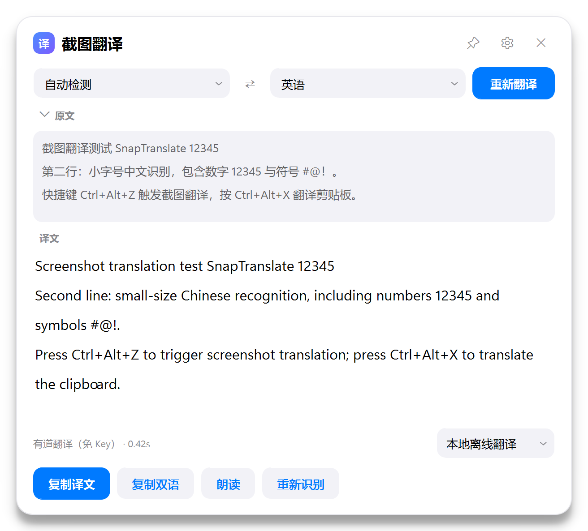
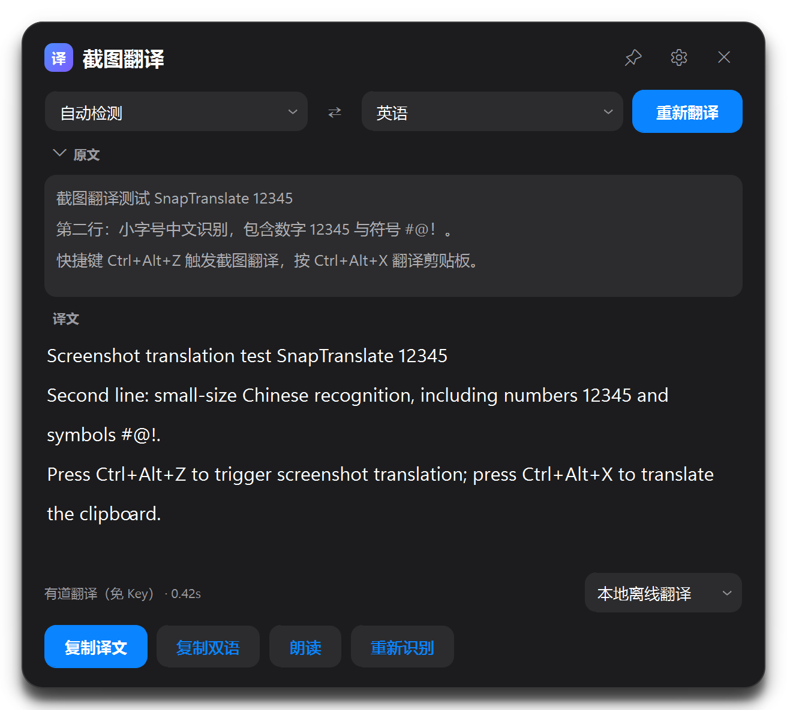
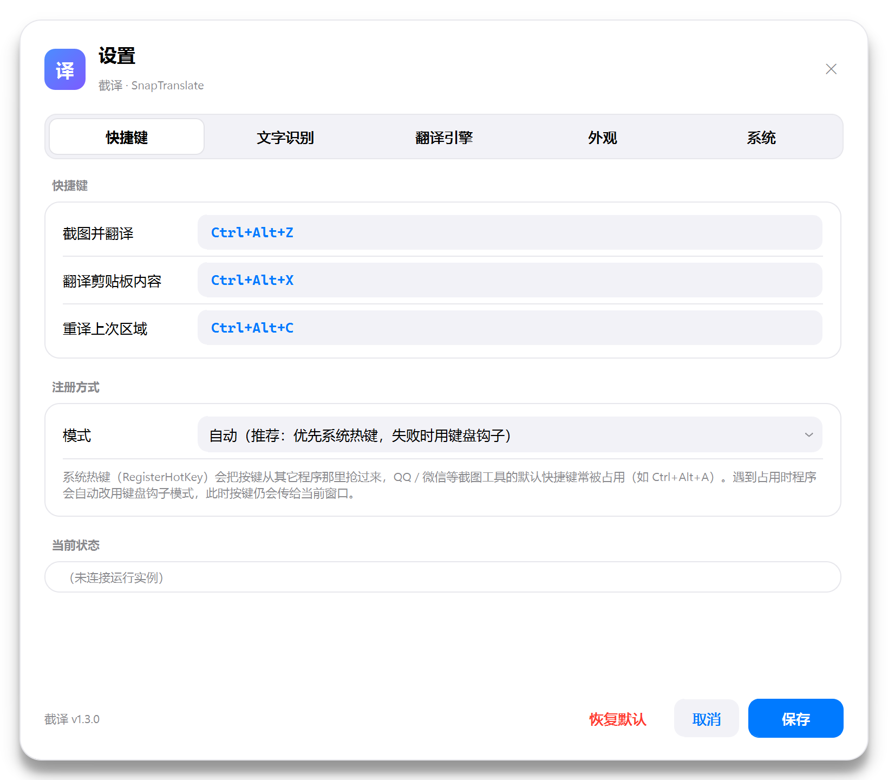
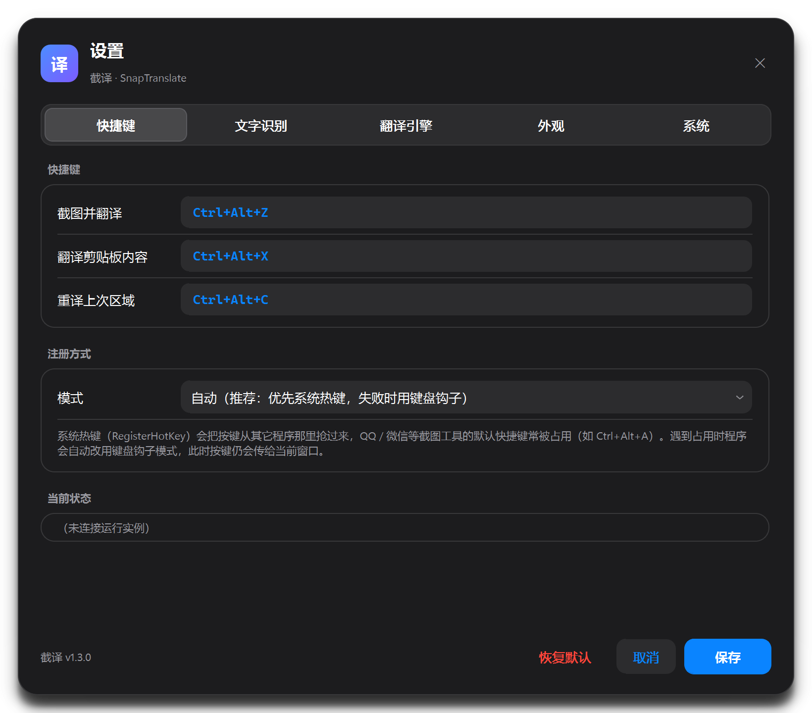

<!-- ═══════════════════════════════════════════════════════════════════════
     SnapTranslate v1.3.0 — bilingual release notes
     语言切换 / Language:  English  ·  简体中文
     ═══════════════════════════════════════════════════════════════════════ -->

# SnapTranslate v1.3.0 · 截译

**English** &nbsp;·&nbsp; [简体中文](#简体中文)

---

## English

> Press a hotkey → drag over any text on screen → offline OCR → floating translation window.

### 🆕 What's new in v1.3.0

**100+ languages, and a picker you can type into.**

The language list grew from 25 to **107 languages**. Both pickers in the result window and
settings now accept a Chinese name or an ISO code — type `fr`, `ja` or `zh-CHS` instead of
scrolling through a long list.

| Result window — light | Result window — dark |
| --- | --- |
|  |  |

- **107 languages** — all major European, Middle Eastern, South Asian, Southeast Asian and
  African languages, plus the ones already supported (Chinese, English, Japanese, Korean…)
- **Searchable language pickers** — click and type; matching is case-insensitive and works
  with display names or codes
- **Correct target-language handling** — selecting French / German / Spanish / Japanese no
  longer makes the app treat Latin text as “already translated” and flip it to Chinese.
  Non-CJK targets now translate all text normally; an already-target-language result falls
  back to English, not Chinese
- **Expanded provider mappings** — Google (`zh-CN` / `zh-TW` / `iw` / `jw`), MyMemory,
  Yandex, Baidu, the LLM prompt names and Argos language codes all share one normalisation
  table (`zh-CN` → `zh-CHS`, `iw` → `he`, `nb` → `no`, `jp` → `ja`, …)
- **Unified offline language names** — the language-pack manager now uses the same Chinese
  names as the rest of the app; Argos `nb` / `pb` map to Norwegian / Portuguese correctly
- **Local offline coverage unchanged and still private** — the Argos index has 100 packs
  covering about 50 languages, pivoting through English for other pairs. Local auto-detect
  is script-based; for Latin-script sources, pick the source language manually for the
  best result

| Settings — light | Settings — dark |
| --- | --- |
|  |  |

**Correctness fixes**

- Latin-script targets are no longer filtered line-by-line by *script*. English and French
  are both Latin, so the old filter could skip every line of an English screenshot when the
  target was French
- Reverse translation for non-Chinese targets now goes to **English** instead of Chinese
- Detected language codes from providers are normalised before comparison, so
  `zh-CN` / `zh-TW` are recognised as Chinese and `iw` as Hebrew
- Repeat requests and cached results use the same normalised target code

**Unchanged**

- OCR engines, translation providers, privacy behaviour, hotkeys and the iOS-style UI from
  v1.2.0 are untouched

### 📦 Download

| File | Description |
| --- | --- |
| **`SnapTranslate-win64.zip`** | Portable build. Extract and run `SnapTranslate.exe`. **No Python required.** |
| `Source code (zip)` | Source. Run `python tools\install_deps.py` first. |

> If SmartScreen blocks the first launch, choose **More info → Run anyway** (the binary is not
> code-signed).

### 🚀 Quick start

1. Extract `SnapTranslate-win64.zip`
2. Run `SnapTranslate.exe` (the settings window opens on first start)
3. Press **`Ctrl + Alt + Z`** and drag over any text

| Default hotkey | Action |
| --- | --- |
| `Ctrl + Alt + Z` | Screenshot & translate |
| `Ctrl + Alt + X` | Translate the clipboard |
| `Ctrl + Alt + C` | Re-translate the last region |

**For offline translation:** *Settings → Translation engines → Manage offline packs* →
download the pair you need → set the engine to **Local offline translation**.

### ✅ Verified before release

| Item | Result |
| --- | --- |
| Language registry (`tools/test_languages.py`) | 62 assertions pass: 107 unique languages, every display name / provider mapping present |
| Translation regression (`tools/test_translation.py --no-net`) | 55 assertions pass |
| Online smoke tests | Yandex: English → French / Russian / Hindi / Thai / Japanese, and auto-fallback to Swahili / Cebuano / Urdu / Persian / Vietnamese; MyMemory: English → Hawaiian. Google is implemented but was blocked by the test network |
| Target-language edge cases | English → French no longer skipped; French original + French target falls back to English, not Chinese; English original + English target falls back to Chinese |
| UI | Searchable pickers render correctly in the result window and settings; existing UI geometry checks still pass |
| Frozen build | OCR → local translation → display passes |

### ⚠️ Known limitations

- **Windows only** (Win32 hotkeys, GDI capture, SAPI speech, WinRT OCR)
- Actual language coverage depends on the engine: Yandex / MyMemory cover most of the list;
  Google needs a proxy in mainland China; some rare pairs may fail on every free endpoint
- Offline translation is English-centric and auto-detection is script-based; pick the source
  language manually for Latin-script sources
- Offline quality is below the online engines — compact OPUS-MT models run on CPU
- The RapidOCR Chinese model drops spaces between English words (boundary spaces are restored automatically)
- With monitors at **different** scaling factors the overlay may be slightly offset
- The binary is not code-signed

### 🔧 Run from source

```bat
python tools\install_deps.py     :: installs into the local vendor\ directory
python main.py                   :: start
python tools\test_languages.py   :: language registry / multi-target path tests
python tools\offline_pack.py --download zh-en en-zh   :: offline language packs
```

See **README.md** for the full guide, FAQ and implementation notes.

### 🙏 Credits

- [RapidOCR](https://github.com/RapidAI/RapidOCR) / [PaddleOCR](https://github.com/PaddlePaddle/PaddleOCR) — offline text recognition
- [CTranslate2](https://github.com/OpenNMT/CTranslate2) / [OPUS-MT](https://github.com/Helsinki-NLP/Opus-MT) — offline translation models
- [Argos Translate](https://github.com/argosopentech/argos-translate) — language-pack format and index
- [PyQt5](https://www.riverbankcomputing.com/software/pyqt/) — GUI
- [mss](https://github.com/BoboTiG/python-mss) — screen capture
- [pynput](https://github.com/moses-palmer/pynput) — keyboard hook fallback

### 📄 License

[MIT](LICENSE)

---

<a id="简体中文"></a>

## 简体中文

> 按下快捷键 → 框选屏幕上任意文字 → 自动识别 → 翻译结果悬浮窗。

### 🆕 v1.3.0 新增

**100+ 种语言，而且下拉框可以直接打字搜索。**

语言表从 25 种扩充到 **107 种**。结果窗和设置里的语言下拉框都支持输入中文名或
ISO 代码——不用在长列表里滚，直接打 `fr`、`ja`、`zh-CHS` 就能定位。

| 结果窗口 · 浅色 | 结果窗口 · 深色 |
| --- | --- |
|  |  |

- **107 种语言** —— 覆盖欧洲、中东、南亚、东南亚、非洲的主要语种，
  以及原有的中、英、日、韩等语言
- **可搜索的语言下拉框** —— 点开直接输入，中文名和语言代码都能匹配，不区分大小写
- **目标语言处理修正** —— 选法语 / 德语 / 西班牙语 / 日语时，不再把拉丁文字
  当成「已经是目标语言」而跳过整行，也不会莫名其妙反向翻成中文；非中文目标
  在原文已是目标语言时兜底译成**英文**
- **补齐各家代码映射** —— Google（`zh-CN` / `zh-TW` / `iw` / `jw`）、MyMemory、
  Yandex、百度、大模型提示词以及 Argos 代码共用一张归一化表
  （`zh-CN` → `zh-CHS`、`iw` → `he`、`nb` → `no`、`jp` → `ja`……）
- **离线语言名统一** —— 语言包管理器使用和主界面一致的中文名；
  Argos 的 `nb` / `pb` 正确显示为挪威语 / 葡萄牙语
- **本地离线仍然专注隐私** —— Argos 索引 100 个语言包，覆盖约 50 种语言，
  其它语种经英语中转；本地源语言自动检测按文字系统判断，
  翻译拉丁语系原文时建议手动指定源语言

| 设置 · 浅色 | 设置 · 深色 |
| --- | --- |
|  |  |

**正确性修复**

- 拉丁文字目标不再按字符系统过滤：英语和法语都是拉丁字母，旧逻辑会把英语截图
  的每一行都当成「已经是法语」而跳过
- 非中文目标的反向翻译改为**英文**，不再出现「选法语却给中文」的情况
- 引擎返回的检测语言先归一化再比较，`zh-CN` / `zh-TW` 能识别为中文、`iw` 能识别为希伯来语
- 重译请求和缓存命中使用同一套归一化目标代码

**没有改动的部分**

- OCR 引擎、翻译服务、隐私行为、快捷键和 v1.2.0 的 iOS 风格界面保持不变

### 📦 下载

| 文件 | 说明 |
| --- | --- |
| **`SnapTranslate-win64.zip`** | 免安装版，解压后双击 `SnapTranslate.exe`，**不需要装 Python** |
| `Source code (zip)` | 源码，需要先执行 `python tools\install_deps.py` 装依赖 |

> 首次运行如果被 SmartScreen 拦下，选「更多信息 → 仍要运行」即可（程序没有代码签名）。

### 🚀 快速上手

1. 解压 `SnapTranslate-win64.zip`
2. 双击 `SnapTranslate.exe`（首次会打开设置窗口）
3. 按 **`Ctrl + Alt + Z`** 框选屏幕上要翻译的文字

| 默认快捷键 | 作用 |
| --- | --- |
| `Ctrl + Alt + Z` | 截图翻译 |
| `Ctrl + Alt + X` | 翻译剪贴板 |
| `Ctrl + Alt + C` | 重译上次区域 |

**要用离线翻译**：设置 → 翻译引擎 → 管理离线语言包 → 下载需要的语言对，
再把「翻译引擎」选为 **本地离线翻译**。

### ✅ 发布前的实测结果

| 项目 | 结果 |
| --- | --- |
| 语言表（`tools/test_languages.py`） | 62 项断言通过：107 个唯一语种，显示名 / 各家代码映射齐全 |
| 翻译回归（`tools/test_translation.py --no-net`） | 55 项断言通过 |
| 在线实测 | Yandex：英语 → 法语 / 俄语 / 印地语 / 泰语 / 日语，自动兜底到斯瓦希里语 / 宿务语 / 乌尔都语 / 波斯语 / 越南语；MyMemory：英语 → 夏威夷语。Google 已实现，但测试网络下直连超时 |
| 目标语言边界 | 英语 → 法语不再被跳过；法语原文 + 法语目标会兜底译成英语而不是中文；英语原文 + 英语目标兜底译成中文 |
| 界面 | 结果窗和设置里的可搜索语言下拉框显示正常；原有界面几何自检仍通过 |
| 打包版 | 识别 → 本地翻译 → 显示 全链路通过 |

### ⚠️ 已知限制

- **仅支持 Windows**（依赖 Win32 热键、GDI 抓屏、SAPI 朗读、WinRT OCR）
- 实际语言覆盖取决于引擎：Yandex / MyMemory 覆盖大部分，Google 在国内需要代理；
  少数冷门语言对可能在所有免费通道上都失败
- 离线翻译以英语为中心，源语言自动检测按文字系统判断；翻译拉丁语系原文时
  手动指定源语言效果最好
- 离线翻译质量低于在线引擎——它用的是能在 CPU 上跑的紧凑型 OPUS-MT 模型
- RapidOCR 中文模型会吞掉英文词间空格（汉字与西文交界处已自动补齐）
- 多显示器**且各屏缩放比例不同**时，框选遮罩按主屏比例渲染，可能有轻微偏移
- 程序无代码签名

### 🔧 从源码运行

```bat
python tools\install_deps.py     :: 依赖装进项目内的 vendor\ 目录
python main.py                   :: 启动
python tools\test_languages.py   :: 语言表 / 多目标语种路径测试
python tools\offline_pack.py --download zh-en en-zh   :: 下载离线语言包
```

详细说明、常见问题与实现要点见仓库根目录的 **README.zh-CN.md**。

### 🙏 致谢

- [RapidOCR](https://github.com/RapidAI/RapidOCR) / [PaddleOCR](https://github.com/PaddlePaddle/PaddleOCR) —— 离线文字识别
- [CTranslate2](https://github.com/OpenNMT/CTranslate2) / [OPUS-MT](https://github.com/Helsinki-NLP/Opus-MT) —— 离线翻译模型
- [Argos Translate](https://github.com/argosopentech/argos-translate) —— 语言包格式与索引
- [PyQt5](https://www.riverbankcomputing.com/software/pyqt/) —— 图形界面
- [mss](https://github.com/BoboTiG/python-mss) —— 屏幕抓取
- [pynput](https://github.com/moses-palmer/pynput) —— 键盘钩子兜底

### 📄 License

[MIT](LICENSE)
